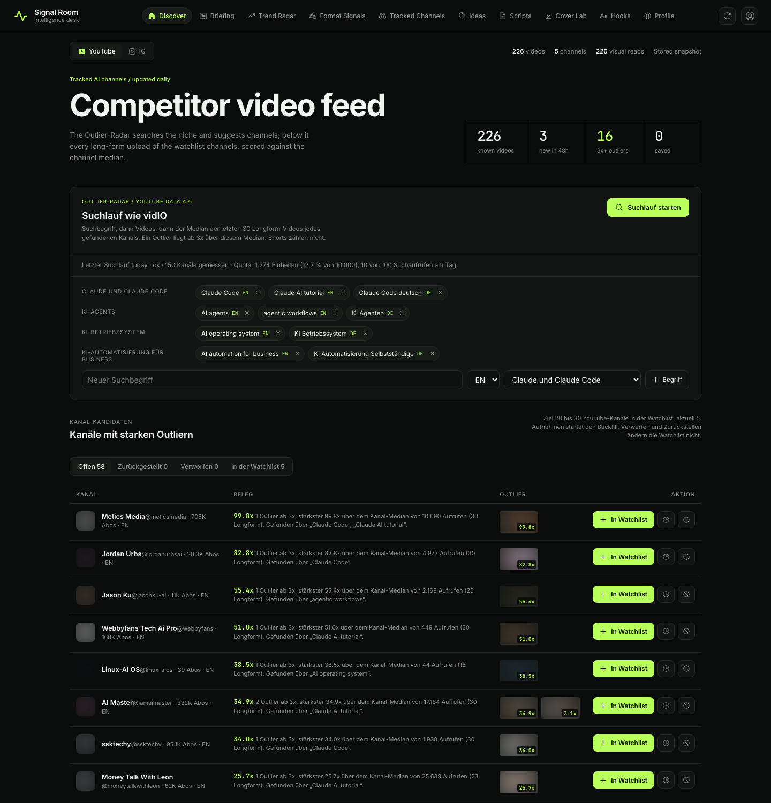
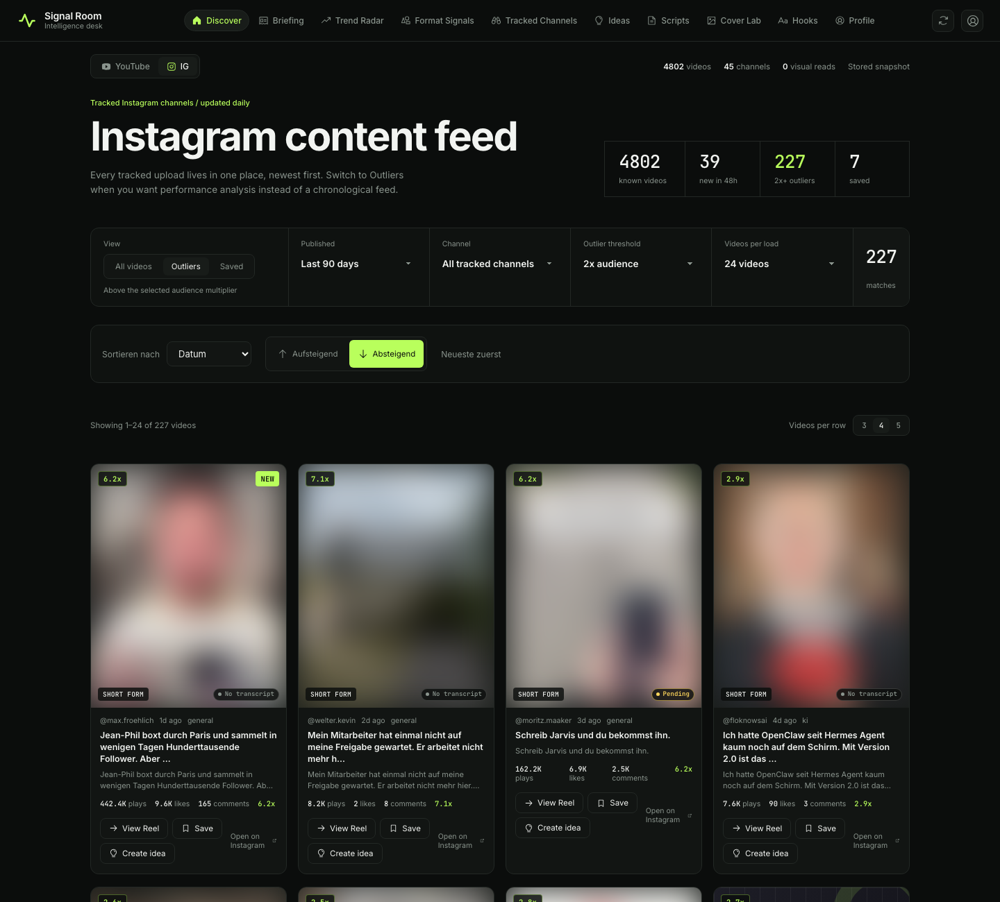
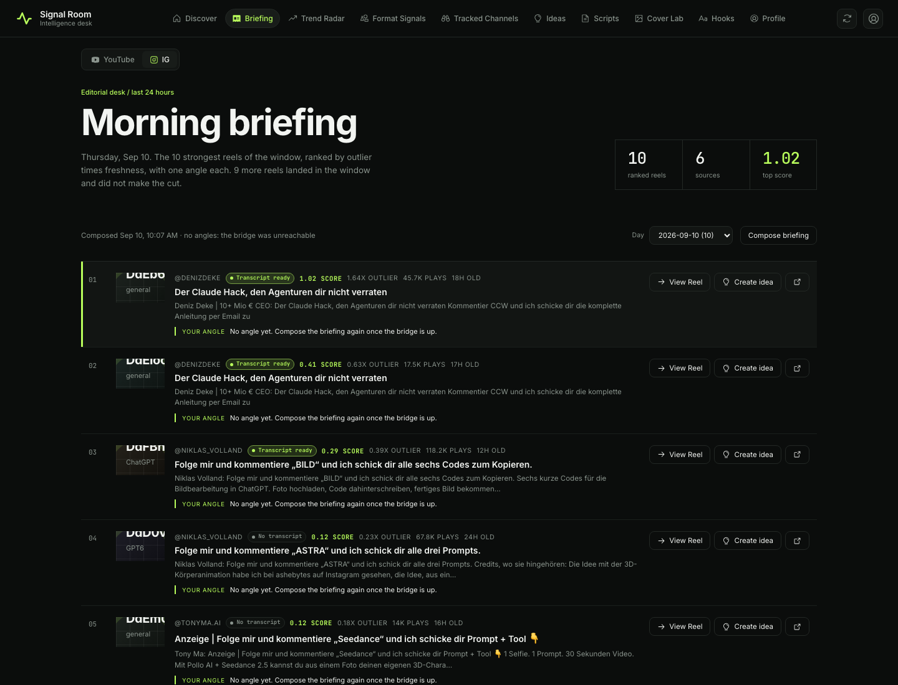
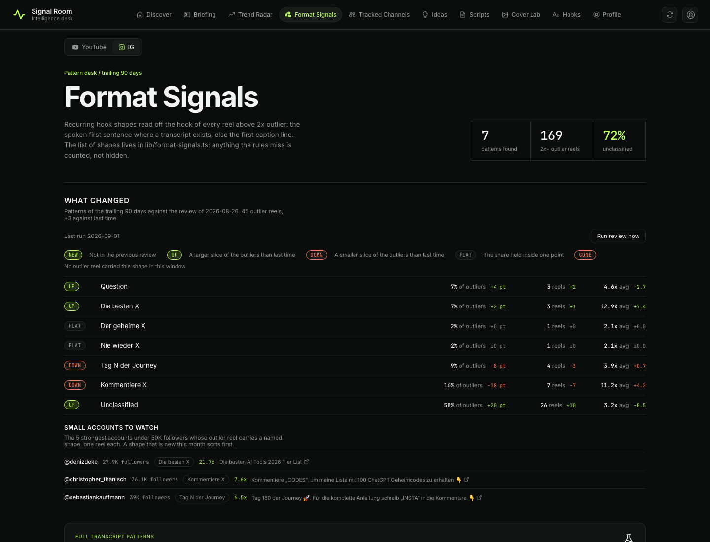
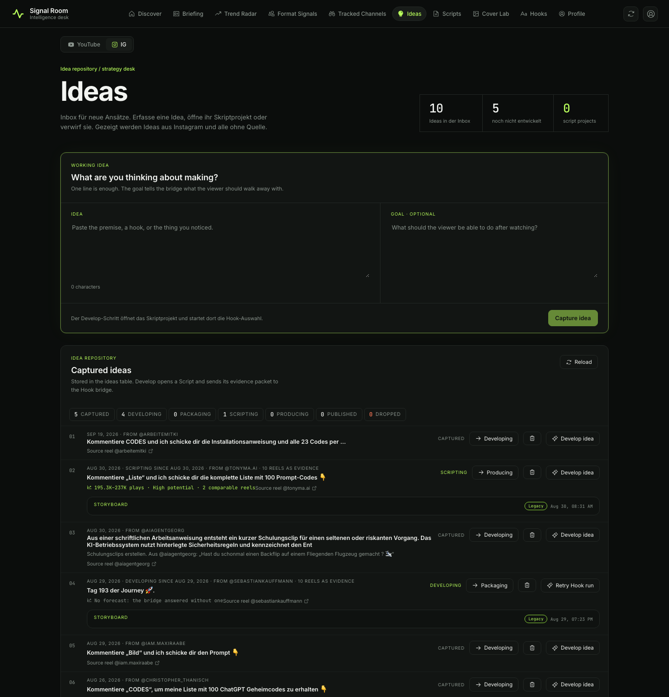
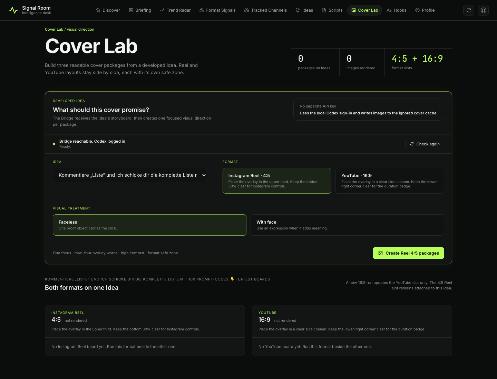

# Signal Room

Signal Room ist meine persönliche Content-Intelligence-App für Instagram-Reels und YouTube. Sie beobachtet Creator in meiner Nische (KI-Tools, Claude, KI-Agenten), erkennt Videos, die deutlich über dem Schnitt ihres Kanals laufen, und macht daraus belegte Ideen, Skripte und Cover.

> **Portfolio-Stand, kein Starter.** Dieses Repo ist eine Momentaufnahme meines privaten Projekts. Es zeigt, wie ich baue. Es ist nicht als Vorlage gepflegt, bekommt keine Updates und nimmt keine Pull Requests an.



## Was es kann

**Instagram-Radar.** Eine Watchlist aus Creatorn wird täglich über Apify eingesammelt. Jedes Reel bekommt einen Outlier-Wert gegen den Median des eigenen Kanals und gegen die Followerzahl. Transkripte der stärksten Reels werden automatisch geholt, Hook-Muster und Formate werden daraus abgeleitet. Das Morning Briefing zeigt jeden Morgen die zehn stärksten Reels der letzten 24 Stunden.

**YouTube-Outlier-Radar (in Arbeit).** Suchbegriffe pro Thema, dann der Median der letzten 30 Longform-Videos jedes gefundenen Kanals. Ab dreifachem Median gilt ein Video als Outlier, Kanäle mit starken Outliern landen als Kandidaten in einer Inbox. Der Screenshot oben zeigt den aktuellen Entwicklungszweig. Der Code dazu ist in diesem Stand noch nicht enthalten.

**Ideen.** Aus jedem Reel wird mit einem Klick eine Idee. Eine Idee wandert durch feste Stufen bis zum fertigen Skript. Hooks, Beats und CTA entstehen aus den gesammelten Belegen, jede Behauptung zeigt auf das Reel, aus dem sie kommt. Ein Lektorat prüft die Skripte auf KI-Sprech, bevor ich sie freigebe.

**Covers.** Der Cover Lab baut pro Idee drei Cover-Pakete, als Reel im Format 4:5 und als YouTube-Thumbnail im Format 16:9.

Alles, was ein Modell schreibt, bleibt ein Vorschlag. Veröffentlicht, verschickt oder gelöscht wird nichts ohne meine Freigabe.

## Einblicke

Gesichter und Cover fremder Creator sind unscharf gemacht. Handles, Titel und Zahlen sind öffentliche Daten.

| | |
|---|---|
|  |  |
| Instagram-Feed, gefiltert auf Outlier | Morning Briefing der letzten 24 Stunden |
|  |  |
| Wiederkehrende Hook-Formate der Outlier | Ideen-Inbox mit Stufen und Quell-Reel |
|  | |
| Cover Lab für Reel und YouTube | |

## Tech-Stack

- Next.js 16 und React 19, TypeScript
- Convex als Datenbank, für Crons und Server-Funktionen
- Apify für Instagram-Profile, Hashtags und Transkripte
- YouTube Data API für das Outlier-Radar (im Entwicklungszweig)
- Lokale Codex-Bridge (OpenAI Codex SDK) für Texte und Bilder, nur auf localhost
- Tests mit dem Node-Test-Runner und Vitest

Architektur und Entscheidungen stehen in `docs/ARCHITECTURE.md`, `docs/SECURITY.md` und `docs/adr/`. Die ADRs beschreiben das private Original, daher der Hinweis auf ein nicht veröffentlichtes Repo.

## Lokal starten

Voraussetzung: Node.js 22.18 oder neuer.

```bash
cp .env.example .env.local
npm install
npm run dev:web
```

Dann http://localhost:3000 öffnen. Ohne Zugangsdaten läuft die App im Demo-Modus mit erfundenen Daten. Für echte Daten braucht es ein eigenes Convex-Deployment, einen Apify-Token und eine lokale Codex-Anmeldung. Welche Variablen es gibt, steht kommentiert in `.env.example`.

```bash
npm run check   # Typecheck, Tests und Build
```

## Herkunft und Lizenz

Signal Room ist aus dem öffentlichen Signal Room Starter der Early AI-dopters entstanden und steht wie dieser unter der MIT-Lizenz, siehe `LICENSE`.
